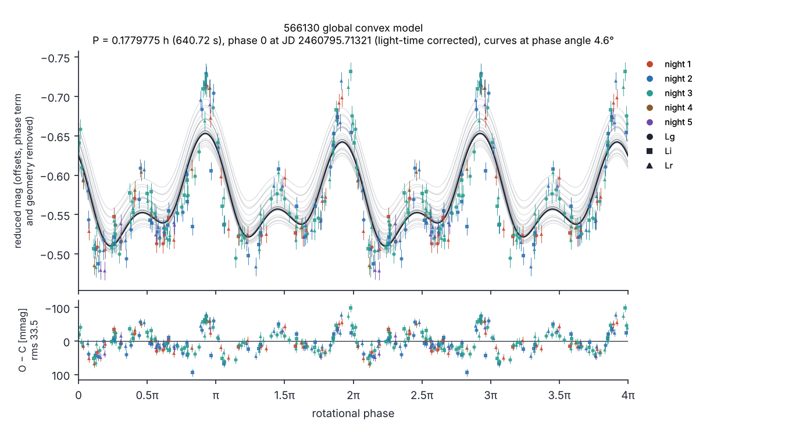
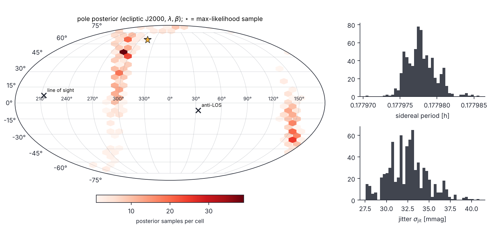
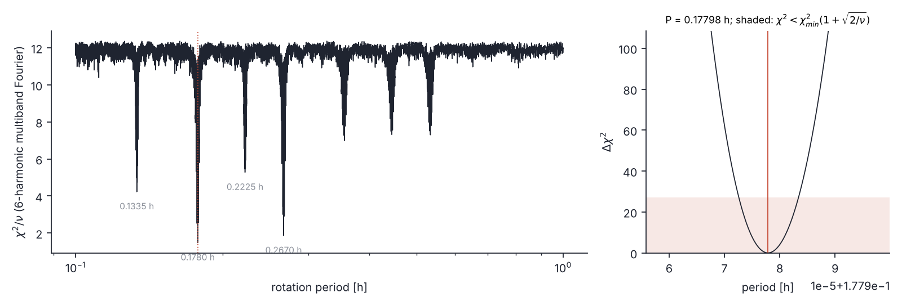
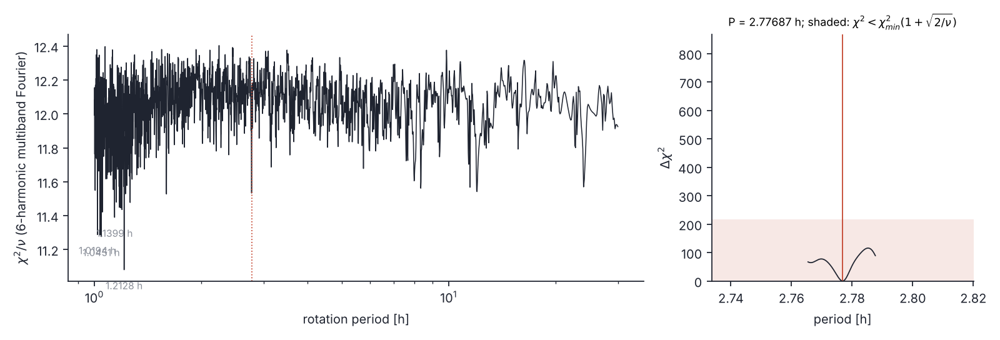
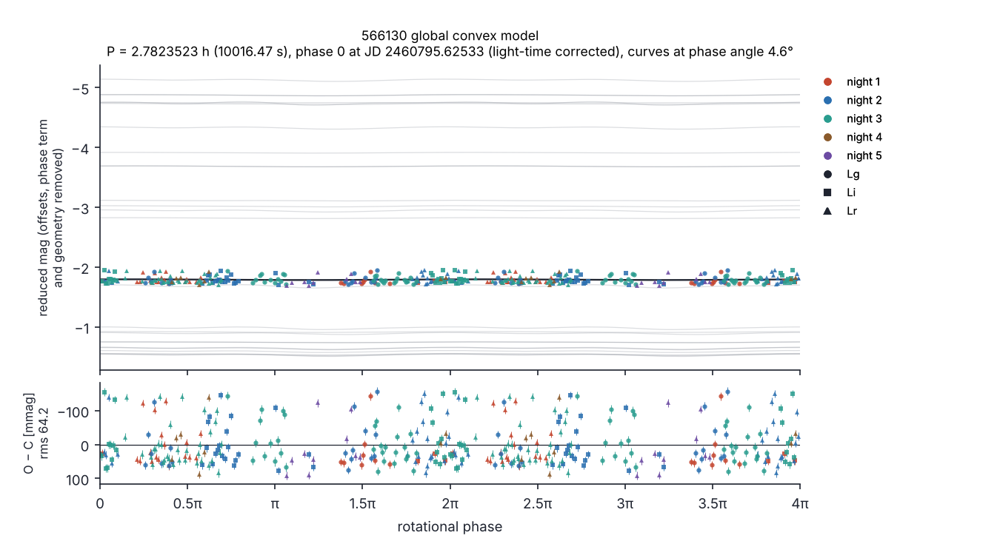

# ADES survey photometry

Survey photometry reaches lcinv as MPC ADES files: one row per observation, from many
stations, with their own bands and uncertainties. This example inverts the Rubin photometry of
566130 from the bundled ADES file, a fast rotator whose 30 s exposures each cover a noticeable
part of a rotation. It also shows what goes wrong when the period search does not reach the true
period.

**Data:** `data/566130_ades.csv`, 438 rows from 11 stations (2007–2026); 195 from Rubin (X05)
over five nights, 2025 Apr 28 – May 5. **Runtime:** about 15 minutes on 2 CPU cores.

## Select the data

```bash
python run_inversion.py data/566130_ades.csv --stations X05 --observer local --exptime 30 \
    --fit-cl --pmin 0.1 --pmax 1 --cache-dir data \
    --nlive 60 --dlogz 1.0 --maxcall 4000 --npool 2 --n-post 40 --n-obj 5 --device cpu \
    --outdir runs/566130_X05_fast
```

| Option | Why |
|---|---|
| `--stations X05` | one station: consistent calibration, filters `Lg`, `Lr`, `Li` |
| `--observer local` | Rubin geometry from the geocentre plus astropy's Earth ephemeris, so only the asteroid's heliocentric vectors are queried; the aspect angles change by less than 10″ |
| `--exptime 30` | the file has no `exp` values; Rubin visits are 30 s |
| `--fit-cl` | fit the Lambert weight \(c_L\) of the scattering law |
| `--pmin 0.1 --pmax 1` | search 6 min to 1 h. The default range starts at 2 h; [see below](#what-happens-with-the-default-search-range) |

ADES uncertainties come from `rmsMag`, with a floor for sparse groups: see
[Input data](../guide/input-data.md).

## First pass

<div class="run-output" markdown>

```text
195 points, bands ['Lg', 'Li', 'Lr'], nights 5; geometry vs file: {}
clipped 1 outlier(s) (> 5 robust sigma from the Fourier fit): JD 2460794.77271 Li
period 0.17798 h (Delta chi2=1: +-0.00000; threshold half-width 0.00001); amplitude 0.215+-0.008; a/b >= 1.191
exposure smearing: T = 30.0 s (median), rotation swept 16.9 deg, 4 node(s) per exposure
nested sampling: 273 iterations, 4073 likelihood calls (efficiency 6.7%), 199 s, ln Z = 317.52 +- 1.87
== convergence: nested sampling: NOT CONVERGED ==
   ln Z = 317.52 +- 1.87 [fail]; evidence left in live points 100% (dlogz 19.05) [fail]; ESS 4 [fail]
   prograde fraction 0.527 +- 0.261 [fail]
   -> 100% of the evidence is still in the final live points: the run stopped early (--maxcall reached); rerun to completion or continue with --resume --extra-calls N
   -> posterior ESS is low: increase --nlive (e.g. x2) or lower --dlogz to 0.1
   -> ln Z is noisy: increase --nlive
best fit (convex): N = 194, p_eff = 14.5 (nominal 32), chi2_red = 9.58 (quoted errors) / 1.02 (with jitter 33.9 mmag), rms 34.8 mmag
```

</div>

- **Geometry.** ADES files carry no distances or phase angles, so there is nothing to compare
  (`{}`).
- **Period.** 0.17798 h = 640.7 s, with a formal error of 0.004 s: the five nights span about 920
  rotations.
- **Smearing.** A 30 s exposure sweeps 16.9° of rotation. lcinv averages the model over each
  exposure with 4 Gauss–Legendre nodes, chosen automatically; see
  [Exposure smearing](../guide/smearing.md).
- **Convergence.** Stopped at `--maxcall`, as intended. Continue it:

```bash
python run_inversion.py data/566130_ades.csv --stations X05 --observer local --exptime 30 \
    --fit-cl --pmin 0.1 --pmax 1 --cache-dir data \
    --nlive 60 --dlogz 1.0 --npool 2 --n-post 40 --n-obj 5 --device cpu \
    --outdir runs/566130_X05_fast --resume --extra-calls 20000
```

<div class="run-output" markdown>

```text
finalised from checkpoint: 646 iterations, 21358 calls, 612 s, ln Z = 318.76 +- 0.43
== convergence: nested sampling: CONVERGED WITH WARNINGS ==
   ln Z = 318.76 +- 0.43 [ok]; evidence left in live points 41% (dlogz 0.53) [warn]; ESS 188 [warn]
   prograde fraction 0.592 +- 0.036 [ok]
   -> 41% of the evidence is still in the final live points: the run stopped early (finalised from a checkpoint); rerun to completion or continue with --resume --extra-calls N
   -> posterior ESS is low: increase --nlive (e.g. x2) or lower --dlogz to 0.1
best fit (convex): N = 194, p_eff = 14.6 (nominal 32), chi2_red = 8.88 (quoted errors) / 1.06 (with jitter 31.8 mmag), rms 33.5 mmag
```

</div>

The sampler reached `--dlogz 1.0` after 21,358 calls. With 60 live points, the evidence and
effective sample size are only just adequate, but the posterior already matches the full reference
run of the same model (`results/566130_X05_cl`, 30 s exposures, \(c_L\) fitted):

| | this run | reference |
|---|---|---|
| period [h] | 0.1779777 (0.1779758–0.1779798) | 0.1779773 (0.1779755–0.1779792) |
| jitter [mmag] | 32.5 (30.3–34.7) | 32.5 (30.1–34.7) |
| prograde fraction | 0.59 | 0.60 |
| projected \(a/b\) | 1.201 (1.194–1.208) | 1.201 (1.194–1.210) |
| \(c_L\) | 0.014 (0.011–0.027) | 0.014 (0.011–0.022) |
| \(\ln Z\) | 318.8 ± 0.4 | 319.6 ± 0.3 |

<div class="lc-two" markdown>

<figure markdown>

<figcaption>Data and model over two rotations of 640.7 s. Two unequal maxima, 0.2 mag
amplitude; the residuals (rms 34 mmag) still show structure the convex model with
\(l_\max = 4\) misses.</figcaption>
</figure>

<figure markdown>

<figcaption>The pole lies on two arcs, at \(\lambda \approx 300°\) and
\(\lambda \approx 140°\), perpendicular to the line of sight: one apparition again leaves
the mirror ambiguity and the latitude open.</figcaption>
</figure>

</div>

The residual structure and the 32 mmag jitter, nearly three times the quoted errors, are what the
[model comparison](post-processing.md#comparing-models) of the reference runs addresses: more
shape freedom fits these data much better.



*`fig_periodogram.png`: the multiband Fourier \(\chi^2/\nu\) between 0.1 and 1 h. The minimum at
0.17798 h (\(\chi^2/\nu = 1.44\)) has aliases at 3/2 (0.2670 h, 1.86), 3/4 (0.1335 h, 4.23) and
5/4 (0.2225 h, 5.28) of the period. The right panel zooms on the minimum; the shaded band is the
threshold interval.*

## What happens with the default search range

The default `--pmin 2` suits most asteroids, but not 566130. With the default range the same
command finds a period anyway, and apart from two warnings the run looks almost normal:

```bash
python run_inversion.py data/566130_ades.csv --stations X05 --observer local --exptime 30 \
    --fit-cl --cache-dir data --nlive 60 --dlogz 1.0 --maxcall 4000 --npool 2 \
    --n-post 40 --n-obj 5 --device cpu --outdir runs/566130_X05_quick
```

<div class="run-output" markdown>

```text
195 points, bands ['Lg', 'Li', 'Lr'], nights 5; geometry vs file: {}
clipped 2 outlier(s) (> 5 robust sigma from the Fourier fit): JD 2460794.77271 Li, JD 2460794.77423 Li
period 2.77687 h (Delta chi2=1: +-0.00127; threshold half-width 0.01111); amplitude 0.119+-0.033; a/b >= 1.102
WARNING (period search): the periodogram has a lower minimum at 1.2128 h (chi2/nu 11.08) below --pmin 2 h; the period may be shorter than the searched range (try a smaller --pmin)
WARNING (period search): the Fourier fit at the best period is poor (chi2/nu = 11.53); check the folded lightcurve, and widen --pmin/--pmax if it shows no clear lightcurve
exposure smearing: T = 30.0 s (median), rotation swept 1.1 deg, 2 node(s) per exposure
nested sampling: 271 iterations, 4078 likelihood calls (efficiency 6.6%), 172 s, ln Z = 240.98 +- 1.09
== convergence: nested sampling: NOT CONVERGED ==
   ...
best fit (convex): N = 193, p_eff = 9.4 (nominal 32), chi2_red = 31.80 (quoted errors) / 1.11 (with jitter 61.4 mmag), rms 64.2 mmag
```

</div>

The two warnings (new in lcinv 0.2.0, see
[Period search](../guide/period-search.md#warnings-about-the-search-range)) point at the problem,
and the numbers confirm it:

| | correct (0.1–1 h) | default (2–30 h) |
|---|---|---|
| period | 0.17798 h | 2.77687 h |
| \(\chi^2/\nu\) of the Fourier fit | 1.44 | 11.53 |
| amplitude | 0.215 ± 0.008 mag | 0.119 ± 0.033 mag |
| jitter | 34 mmag | 61 mmag |
| \(\chi^2_\mathrm{red}\), quoted errors | 9.6 | 31.8 |
| \(\ln Z\) (first pass) | 317.5 | 241.0 |

<div class="lc-two" markdown>

<figure markdown>

<figcaption>Default range: a flat periodogram at \(\chi^2/\nu \approx 12\) with no clear minimum;
the deepest dips (labelled, near 1.0–1.2 h) lie below the 2 h limit.</figcaption>
</figure>

<figure markdown>

<figcaption>Folded at 2.78 h the data show no lightcurve, and the model is nearly flat; the
residuals (rms 64 mmag) are the lightcurve.</figcaption>
</figure>

</div>

The jitter term absorbs the unexplained signal, so the reduced \(\chi^2\) with jitter is a
perfectly normal 1.11: **a good \(\chi^2\) with jitter does not show that the period is right.**
Check instead that

- the periodogram has a clear minimum, well below its continuum;
- the jitter is comparable to the quoted errors (here 61 mmag against about 12);
- the folded lightcurve shows a lightcurve.

For a target whose period is unknown, run the period search over the full range first
([Period search from Python](period-search-api.md) does this in seconds), or set `--pmin` from
the shortest period the data can sample. Fast rotators below the 2.2 h spin barrier are common
among small asteroids, which is what surveys like Rubin find in large numbers.
