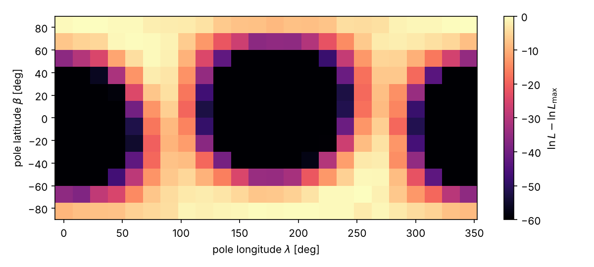

# Likelihood and shape from Python

`run_inversion.py` hands the likelihood to a sampler, but the model is an ordinary Python object.
This example evaluates the Laplace-marginalised likelihood on a grid of poles, which shows the
structure the sampler has to explore, then reconstructs and exports the shape at the best pole.

**Data:** K03Q21N. **Runtime:** under a minute after a few seconds of compilation.

## The script

`examples/docs/convex_api.py`, run from the repository folder:

```bash
PYTHONPATH=. python examples/docs/convex_api.py
```

```python
--8<-- "examples/docs/convex_api.py"
```

## Output

<div class="run-output" markdown>

```text
--8<-- "examples/docs/convex_api.out"
```

</div>



## What it shows

- **Every grid point is a full fit.** `M.loglike(theta)` optimises the 24 shape coefficients for
  that spin state and integrates them out (Laplace), so the map is the marginal likelihood of the
  pole at fixed period and jitter. 288 of them take well under a minute on CPU once compiled.
- **The bright band is physics.** The 0.40 mag amplitude needs an equator-on view, so every
  pole on the great circle perpendicular to the line of sight fits, while poles far from it fall 60 or
  more below the maximum in \(\ln L\) (the colour scale is cut there). Along the band, the near-polar ends fit best.
- **Mirror solutions.** The best northern pole (30°, +82.5°) and southern pole (255°, −67.5°)
  differ by 0.01 in \(\ln L\): one apparition cannot tell them apart. This is why the global layer
  reports both as spin states with their weights.
- **A shape in four lines.** `loglike_jit` returns the optimal coefficients `c`, `M.areas(c)`
  turns them into facet areas, and `minkowski.reconstruct` builds the convex polyhedron (796
  vertices, area mismatch 0.000), written as an OBJ file.
- **Fit quality at the best pole** matches the sampled run: \(\chi^2_\mathrm{red}\) 3.35 with the
  quoted errors and 1.06 with a 17 mmag jitter, 15 effective parameters.

`theta` is \((\lambda, \beta, P, \ln\sigma_\mathrm{jit})\); with `fit_cl=True` add \(\ln c_L\), with
`fit_tau=True` add \(\ln\tau_0\). `M.predict()` evaluates the model at arbitrary epochs for
plotting. API details: [`lcinv.convex`](../reference/api/convex.md),
[`lcinv.minkowski`](../reference/api/minkowski.md).
