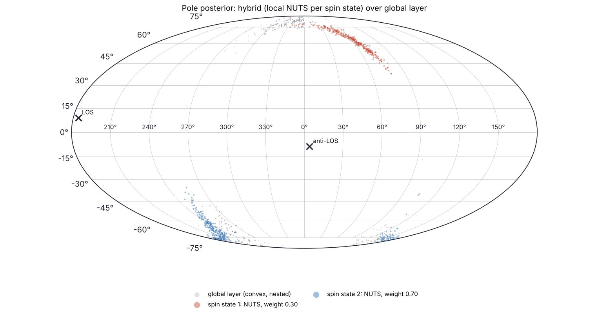
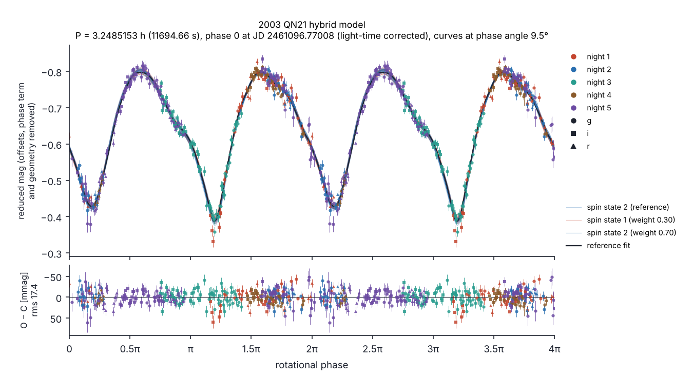
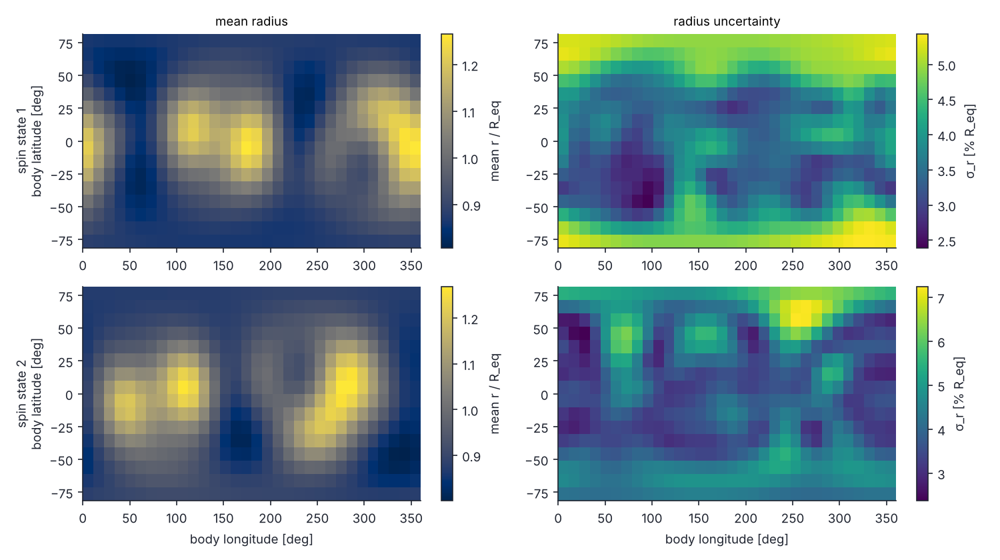
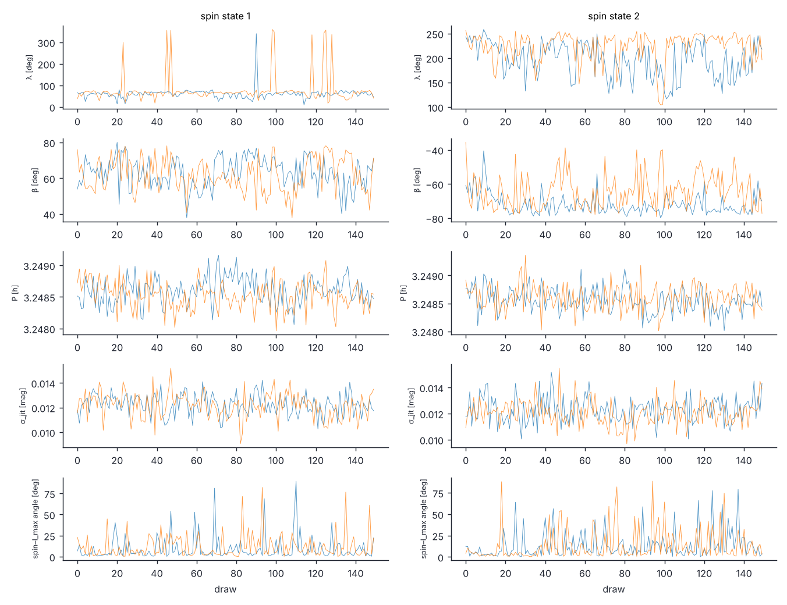

# Hybrid model

The global layer found two spin states for K03Q21N, one near each ecliptic pole, with a convex
shape. The hybrid layer now takes each spin state in turn and samples spin and a non-convex
radius-field shape jointly with NUTS. This example continues from the
[Quickstart](../getting-started/quickstart.md) run.

**Data:** K03Q21N. **Runtime:** 20 minutes on 2 CPU cores (two spin states, about 8 minutes of
NUTS each).

## Run it

```bash
python run_hybrid.py data/K03Q21N.lc --designation K03Q21N --location X05 --cache-dir data \
    --global-dir runs/K03Q21N_quick --chains 2 --warmup 150 --samples 150 --starts 2 \
    --map-iter 800 --device cpu --outdir runs/K03Q21N_quick_hybrid
```

`--global-dir` points at the finished global run, from which the spin states, their centres and
the period prior are read. The chain settings are short on purpose; the defaults are given in the
[`run_hybrid.py` reference](../reference/cli/run_hybrid.md).

<div class="run-output" markdown>

```text
spin states from the global layer: [('spin state 1', 326, 80, 0.4976452119309262), ('spin state 2', 234, -77, 0.5023547880690737)]
grid 16x32, k = 32, SH orthonormality error 3.8e-15
spin state 1 MAP: N = 334, p_eff = 36.4 (nominal 41), chi2_red = 2.22 (quoted errors) / 1.14 (with jitter 10.9 mmag), rms 17.1 mmag
spin state 1: MAP logp 842.08 (starts [840.4 842.1]), |grad| 5.1e-05, ln Z_Laplace 773.42, non-positive curvatures 0  [51s]
== convergence: spin state 1: NOT CONVERGED ==
   R-hat/ESS: d1 1.023/75, d2 1.004/67, P 1.016/112, jitter 1.005/182; divergences 0 [rhat warn, ess fail, div ok]
spin state 1: NUTS 499s (parallel), divergences 0, R-hat lam/bet/P 1.007/1.022/1.016, ESS 88/73/112
spin state 1: convexity 0.1799 R_eq (median max protrusion), shadowing error rms 6.75 mmag, max 24.92 mmag
spin state 2 MAP: N = 334, p_eff = 36.7 (nominal 41), chi2_red = 2.21 (quoted errors) / 1.14 (with jitter 10.9 mmag), rms 17.1 mmag
spin state 2: MAP logp 842.16 (starts [842.2 840. ]), |grad| 9.8e-07, ln Z_Laplace 774.26, non-positive curvatures 0  [28s]
== convergence: spin state 2: NOT CONVERGED ==
   R-hat/ESS: d1 1.157/67, d2 1.085/103, P 1.016/191, jitter 1.012/190; divergences 0 [rhat fail, ess fail, div ok]
spin state 2: NUTS 468s (parallel), divergences 0, R-hat lam/bet/P 1.141/1.147/1.016, ESS 78/74/191
spin state 2: convexity 0.2014 R_eq (median max protrusion), shadowing error rms 6.00 mmag, max 24.36 mmag
done in 1169s -> runs/K03Q21N_quick_hybrid
```

</div>

## Reading the output

- **Spin states.** Two, from the global layer: (326°, +80°) and (234°, −77°), with global
  weights 0.50 each.
- **MAP fit.** In both spin states the radius field (\(l_\max = 5\), 32 coefficients) reaches
  \(\chi^2_\mathrm{red} = 1.14\) with 10.9 mmag of jitter, against 17 mmag for the convex model:
  the extra shape freedom fits detail the convex model leaves in the residuals. Two MAP starts
  agree to within 2 in log density.
- **Weights.** The local Laplace evidences, 773.42 and 774.26, give weights 0.30 and 0.70.
  A difference of 0.8 in \(\ln Z\) is not a preference worth reporting.
- **Convergence.** No divergences, but R-hat up to 1.16 and fewer than 100 effective samples on
  the pole: as `check_convergence.py` says, these chains are too short. The
  [reference run](reference-results.md#k03q21n-hybrid-model) with 400 + 400 iterations is the
  one to quote.
- **Checks.** The shapes protrude up to 0.18–0.20 \(R_\mathrm{eq}\) beyond their convex hulls,
  so they are clearly non-convex. Ignoring self-shadowing costs 6–7 mmag rms (25 mmag at worst),
  which is below the jitter.

## The figures



*`fig_pole_hybrid.png`: NUTS draws of each spin state (red, blue) over the global posterior
(grey). Each spin state is an arc perpendicular to the line of sight (LOS), not a blob: along
the arc the pole and the shape trade off. The prograde state settles at a mean pole of
(62°, +63°), 68 % radius 11°; the retrograde one at (221°, −72°), 68 % radius 15°. Both agree with
the reference run, (69°, +59°) and (241°, −66°).*



*`fig_folded_lightcurve_hybrid.png`: data, model curves of both spin states and residuals (rms
17.4 mmag). The two spin states predict nearly identical lightcurves, which is why the data cannot
decide between them.*



*`fig_radius_maps.png`: the posterior mean radius on the body surface and its standard deviation,
3 to 7 % of the equatorial radius. Both spin states find a body with two equatorial bulges
(an elongated, somewhat waisted shape); the polar regions are the least constrained, because
an equator-on view sees them only edge-on.*



*`fig_traces.png`: two chains per spin state. Spin state 1 occasionally jumps across
\(\lambda = 0°/360°\) (a wrap of the longitude, not a mixing problem). In spin state 2 the
longitude still wanders between 100° and 250° and the chains disagree on \(\beta\): the R-hat of
1.15 in the report.*

## Results in numbers

```python
import json
s = json.load(open("runs/K03Q21N_quick_hybrid/summary_hybrid.json"))
for st in s["spin_states"]:
    print(st["name"], round(st["weight_local_laplace"], 2),
          [round(x) for x in st["pole"]["mean_pole"]],
          [round(x, 5) for x in st["P_h"]], round(st["jitter_mag"][1] * 1e3, 1),
          round(st["inertia_angle_deg"][1], 1))
```

```text
spin state 1 0.3 [62, 63] [3.24832, 3.24856, 3.24879] 12.2 4.8
spin state 2 0.7 [221, -72] [3.24835, 3.24857, 3.24882] 12.1 6.1
```

The columns are weight, mean pole, period percentiles (16, 50, 84), median jitter in mmag and
the median angle between spin axis and the axis of maximum inertia in degrees. The period,
3.24857 h, matches the reference hybrid run (3.24853–3.24856 h).

## Products

```bash
python check_convergence.py runs/K03Q21N_quick_hybrid
python export_obj.py runs/K03Q21N_quick_hybrid --n 10
```

```text
spin state 1: wrote mean, median, p16, p84 and 10 draws -> runs/K03Q21N_quick_hybrid/obj/spin_state_1
spin state 2: wrote mean, median, p16, p84 and 10 draws -> runs/K03Q21N_quick_hybrid/obj/spin_state_2
```

`viewer_spin_state_<k>.html` in the run folder shows each shape in 3D with its uncertainty.
More on all products: [Working with finished runs](post-processing.md).

## For a result to publish

```bash
python run_hybrid.py data/K03Q21N.lc --designation K03Q21N --global-dir results/K03Q21N \
    --chains 4 --warmup 1000 --samples 1500 --outdir results/K03Q21N_hybrid
```

Start from a converged global run, use four chains, and confirm with `check_convergence.py`
that R-hat is below 1.01 and the ESS above 400 before quoting poles and weights. Options and the
model: [Hybrid model](../guide/hybrid.md).
