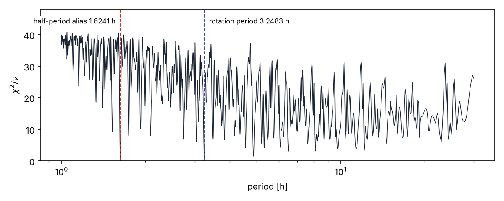

# Period search from Python

The period search behind `run_inversion.py` is plain NumPy in `lcinv.period`, so it runs in
seconds and is easy to use from a notebook: to look at aliases, try other harmonics, or check a
catalogue period before a long inversion.

**Data:** K03Q21N, 334 Rubin points. **Runtime:** about 10 s.

## The script

`examples/docs/period_search.py`, run from the repository folder:

```bash
PYTHONPATH=. python examples/docs/period_search.py
```

```python
--8<-- "examples/docs/period_search.py"
```

## Output

<div class="run-output" markdown>

```text
--8<-- "examples/docs/period_search.out"
```

</div>



## What it shows

- **The coarse grid's best minimum, 3.24741 h, is not the answer.** The grid spacing,
  \(1/(5KT)\) in frequency, is too coarse for the narrow minimum. `refine_period_auto` scans
  around it and lands on 3.24826 h, the value `run_inversion.py` prints and uses.
- **The half-period alias is almost as good.** At 1.62380 h, \(\chi^2/\nu = 1.029\) against 1.012:
  a lightcurve with two nearly equal maxima per rotation fits either. What rules out 1.62 h is
  physics rather than statistics: it lies below the spin barrier (about 2.2 h) for a body with
  H = 16.
- **Two uncertainties.** \(\Delta\chi^2 = 1\) gives ±0.00028 h; the threshold interval
  [3.24682, 3.24965] h, which also allows for model error, is about five times wider. The
  nested sampling prior uses the latter by default.
- **Amplitude.** 0.402 ± 0.007 mag at a mean phase angle of 9.4°, corrected to zero phase with
  \(m = 0.03\): \(a/b \ge 1.337\).

The same functions accept exposure times (`exptime=D["exptime"]`), in which case the fitted
series describes the un-smeared lightcurve; see [Exposure smearing](../guide/smearing.md).
API details: [`lcinv.period`](../reference/api/period.md).
