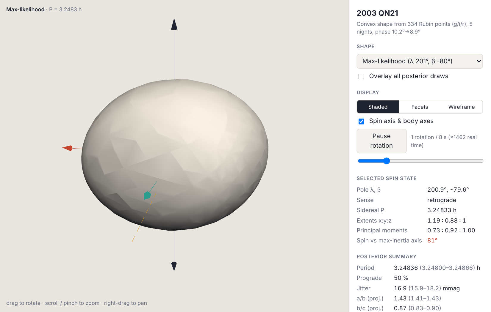
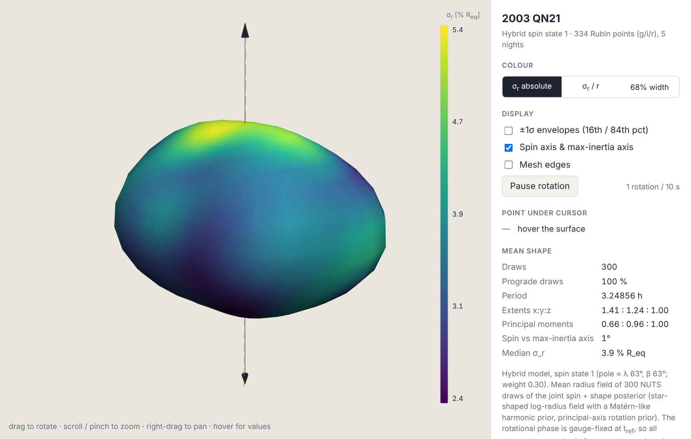

# Working with finished runs

A results folder holds everything needed to rebuild the model, so checks, meshes, viewers and
comparisons never resample. This page runs the post-processing scripts on the
[Quickstart](../getting-started/quickstart.md) and [Hybrid](hybrid-k03q21n.md) runs and on the
shipped 566130 reference runs. Each takes seconds.

## Convergence report

```bash
python check_convergence.py runs/K03Q21N_quick
python check_convergence.py runs/K03Q21N_quick_hybrid
```

<div class="run-output" markdown>

```text
== convergence: runs/K03Q21N_quick (nlive 60, rslice, seed 42): CONVERGED WITH WARNINGS ==
   ln Z = 731.88 +- 0.40 [ok]; evidence left in live points 32% (dlogz 0.39) [ok]; ESS 224 [warn]
   prograde fraction 0.491 +- 0.033 [ok]
   -> posterior ESS is low: increase --nlive (e.g. x2) or lower --dlogz to 0.1
```

```text
== convergence: runs/K03Q21N_quick_hybrid/posterior_spin_state_1.npz: NOT CONVERGED ==
   R-hat/ESS: d1 1.023/75, d2 1.004/67, P 1.016/112, jitter 1.005/182; divergences 0 [rhat warn, ess fail, div ok]
   -> chains have not mixed: increase --warmup/--samples (e.g. 1000/1500) and --chains (4)
== convergence: runs/K03Q21N_quick_hybrid/posterior_spin_state_2.npz: NOT CONVERGED ==
   R-hat/ESS: d1 1.157/67, d2 1.085/103, P 1.016/191, jitter 1.012/190; divergences 0 [rhat fail, ess fail, div ok]
   -> chains have not mixed: increase --warmup/--samples (e.g. 1000/1500) and --chains (4)
```

</div>

The same report is printed at the end of each run and stored under `convergence` in the
summary. The thresholds (`ok` / `warn` / `fail`):

| Check | ok | warn | fail |
|---|---|---|---|
| evidence left in the live points, \(\Delta\ln Z\) | ≤ 0.5 | ≤ 1.0 | > 1.0 |
| \(\ln Z\) error | ≤ 0.5 | ≤ 1.0 | > 1.0 |
| posterior ESS, nested sampling | ≥ 400 | ≥ 150 | < 150 |
| prograde-fraction error | ≤ 0.05 | ≤ 0.10 | > 0.10 |
| R-hat, NUTS | ≤ 1.01 | ≤ 1.05 | > 1.05 |
| ESS, NUTS | ≥ 400 | ≥ 100 | < 100 |
| divergences | 0 | ≤ 10 | > 10 |

`d1`, `d2` are the two coordinates of the gnomonic pole chart that NUTS samples. Given several
folders of the same model, `check_convergence.py` also reports whether repeated runs agree; see
[Convergence](../guide/convergence.md).

## Meshes

```bash
python export_obj.py runs/K03Q21N_quick --diameter-km 1.2
python export_obj.py runs/K03Q21N_quick_hybrid --n 10
```

<div class="run-output" markdown>

```text
wrote shape_maxlike, shape_mean and 20 draws -> runs/K03Q21N_quick/obj
```

```text
spin state 1: wrote mean, median, p16, p84 and 10 draws -> runs/K03Q21N_quick_hybrid/obj/spin_state_1
spin state 2: wrote mean, median, p16, p84 and 10 draws -> runs/K03Q21N_quick_hybrid/obj/spin_state_2
```

</div>

Every file is a closed, outward-oriented triangle mesh with a header that states the pole, period
and frame:

```text
# 2003 QN21: maximum-likelihood convex shape
# lambda=200.91 beta=-79.59 P=3.248333 h, t_ref JD 2461097.176148
# frame: body (z = spin axis; rotational phase 0 at t_ref)
# units: km; origin: centre of mass (uniform density)
v 0.416482 -0.383755 -0.230088
```

The maximum-likelihood mesh has 796 vertices and 1,588 faces; its volume is 0.905 km³, exactly a
1.2 km volume-equivalent sphere, and its extents are 1.40 × 1.06 × 1.17 km. Without
`--diameter-km` the meshes have unit volume. `--frame principal` writes them in the principal-axis
frame instead, and `--H 16 --albedo 0.15` scales them to the CNEOS size estimate.

## Interactive viewers

```bash
python make_viewer.py runs/K03Q21N_quick
```

```text
wrote runs/K03Q21N_quick/shape_viewer.html (0.86 MB, 6 shapes)
```

The page is self-contained: it opens offline and can be sent as one file. The hybrid run writes
its own viewers, `viewer_spin_state_<k>.html`, directly.

<div class="lc-two" markdown>

<figure markdown>

<figcaption>`shape_viewer.html`: the maximum-likelihood convex shape with its spin axis, the
posterior summary and a selector for the posterior draws.</figcaption>
</figure>

<figure markdown>

<figcaption>`viewer_spin_state_1.html`: the hybrid mean shape coloured by its radius
uncertainty, with the maximum-inertia axis.</figcaption>
</figure>

</div>

The two panels show why the hybrid layer has an inertia prior. The convex maximum-likelihood shape
spins about an axis 81° from its axis of maximum inertia, which a relaxed body would not do; the
convex model has no way to know that. The hybrid mean shape of the same data spins within 1° of
it.

## Comparing models

`compare_models.py` reads any mix of convex, binary and hybrid folders, checks that they were
fitted to identical data, and ranks them by evidence:

```bash
python compare_models.py results/566130_X05_cl results/566130_X05 results/566130_X05_smear \
    results/566130_X05_binary --out runs/566130_comparison
```

It prints a Markdown report: a table with, for each model, the fit statistics, \(\ln Z\), its
difference to the best model with the Jeffreys reading and the model probability, then a
recommendation. For these four folders plus the complexity scan stored inside
`results/566130_X05_cl`, the rerun reproduced the shipped `results/566130_comparison.md` line for
line; the full table and how to read it are on
[Reference results](reference-results.md#566130-model-comparison). The recommendation begins:

```text
**Most probable model: convex lmax 8, τ0 0.6, c_L fit, 30 s exp. [scan]**

- **No decision** between *convex lmax 8, τ0 0.6, c_L fit, 30 s exp. [scan]* and *convex lmax 6,
  τ0 0.6, c_L fit, 30 s exp. [scan]* (Δ ln Z = 0.7 ± 0.4); report both.
- Caution: the best model's evidence is from importance sampling (ESS 76); confirm it with a
  full nested run.
- A setting with only a lower bound on ln Z already exceeds the best by +41.5: *convex lmax 6,
  τ0 1.2, c_L fit, 30 s exp. [scan]*. The data support more shape freedom; run it fully
  (complexity_scan.py --full, or run_inversion.py --fit-tau) and compare again.
```

Runs on different data are listed but excluded: the comparison is keyed on the data fingerprint
(`bc74198abb64` here), so the [ADES example](ades-566130.md) run, which clipped the same single
point, could join this table, while the run at the wrong period, which clipped two, could not.

It writes `runs/566130_comparison.md`, `.csv` and `.json`. Reading such a table, and what the
evidence differences mean: [Shape complexity and model comparison](../guide/model-comparison.md).

## From Python

All scripts rebuild their models through [`lcinv.rebuild`](../reference/api/rebuild.md), and the
samples are in `nested_results.pkl`:

```python
import numpy as np
from lcinv import sampler

r = sampler.load("runs/K03Q21N_quick/nested_results.pkl")
print(sorted(r))
post = r["post"]                 # equal-weight posterior: (lambda, beta, P, ln jitter)
print(post.shape)
print(np.percentile(post[:, 2], [16, 50, 84]).round(5))
print(sorted(r["ensemble"]))     # the posterior shape ensemble
```

```text
['args', 'ensemble', 'logl', 'logwt', 'logz', 'logzerr', 'post', 'samples']
(640, 4)
[3.248   3.24836 3.24866]
['ab', 'bc', 'beta', 'c_draw', 'c_hat', 'chi2', 'logL', 'theta']
```

`samples`, `logwt` and `logl` are the raw weighted nested samples, for your own resampling or
plots; `ensemble` holds the shape coefficients (`c_hat` at each draw's optimum, `c_draw` sampled
from its Laplace approximation) with their spin states and axis ratios.
