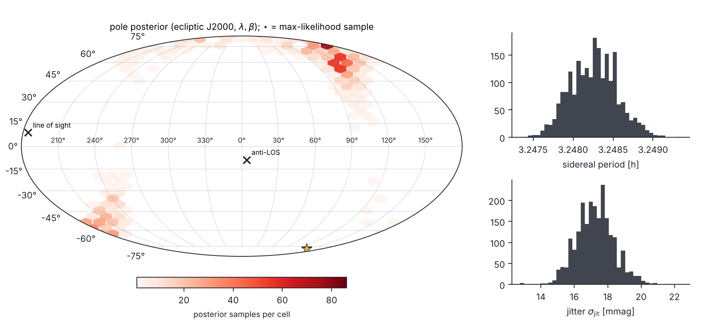
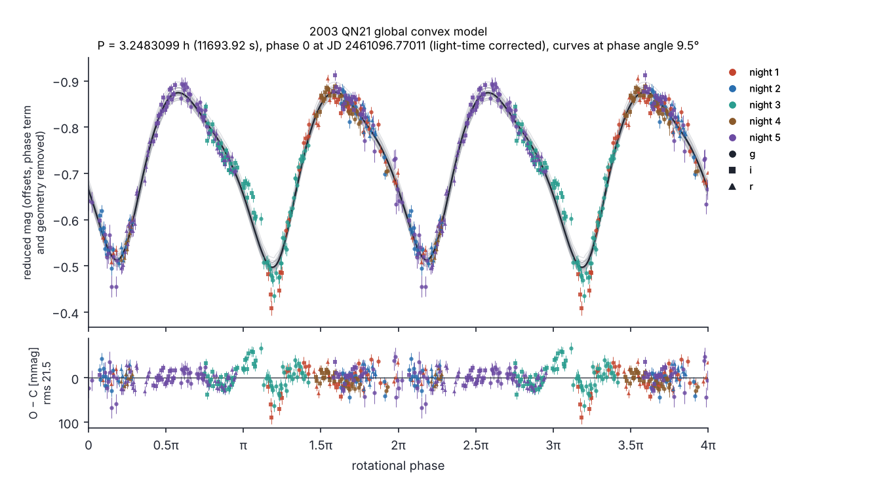
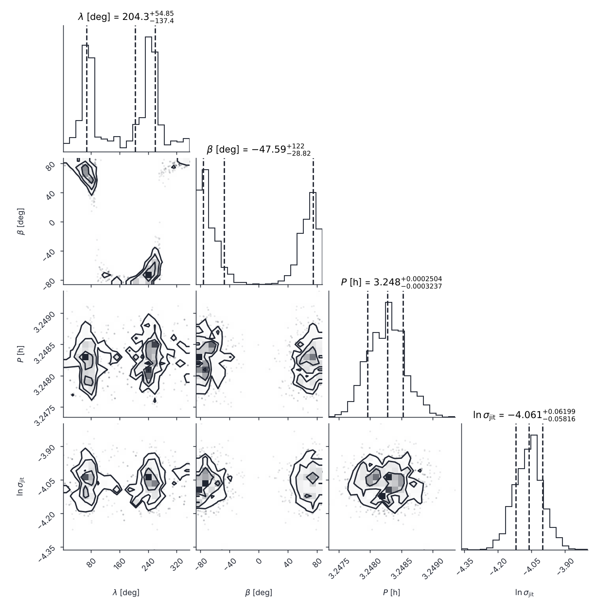
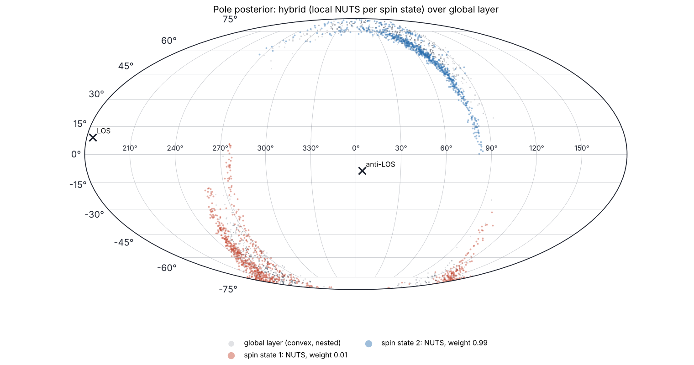
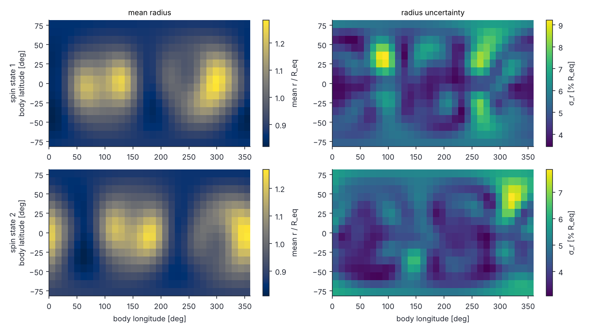
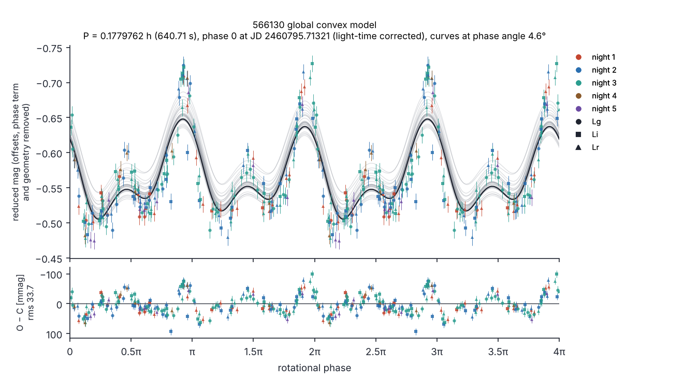
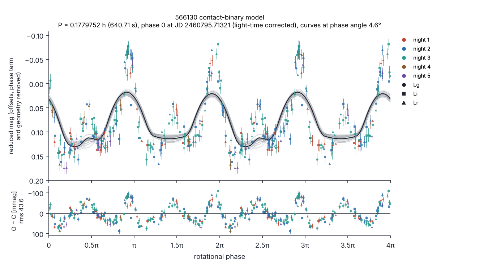

# Reference results

The project ships finished, full-length runs of both bundled targets in `results/`. They use
production settings, unlike the shortened runs of the other examples, and are the numbers to
compare your own runs against. Figures and values on this page are taken directly from those
folders.

## K03Q21N: global layer

`results/K03Q21N`: 334 g/r/i points from Rubin (X05), five nights (2026 Feb 23–27), phase angle
10.2° to 8.9°.

The run used 250 live points with the earlier `unif` sampler and was finalised from its
checkpoint (`--resume`) at \(\Delta\ln Z \approx 2.7\), after 58,660 likelihood calls; its
\(\ln Z = 732.2\) is therefore approximate, while the posterior is well sampled.
`results/K03Q21N_rslice` repeats it with `rslice` and 150 live points (\(\ln Z = 732.5 \pm 0.4\),
same period and jitter).

| Quantity | Result |
|---|---|
| period | 3.24828 h (+0.00025 / −0.00032); the period search gives 3.24826 h |
| pole, prograde mode | (67°, +71°), 47 % |
| pole, retrograde mode | (244°, −73°), 53 % |
| pole uncertainty | 68 % radius about 15°, 95 % radius about 33°, per mode |
| jitter | 17 mmag (16–18), against quoted errors of about 10 mmag |
| axis ratios | projected-area \(a/b\) = 1.42 (1.41–1.44); polyhedron extents \(a/b\) = 1.14 (1.04–1.17), \(b/c\) = 1.10 (1.01–1.17) |
| facet resolution | reweighting to 800 facets: ESS 80 %, mode centres move < 1.3° |



Both modes require an aspect angle of 86° to 94°, an equator-on view. The pole is constrained at
all only because the 0.40 mag amplitude needs that view, given physically shaped bodies
(\(b/c \ge 1\)). The \(\lambda\)–\((\lambda + 180°)\) ambiguity cannot be resolved from one
apparition. The 1.624 h half-period alias fits the Fourier series equally well but lies below the
spin barrier for H = 16. The two axis-ratio measures differ because the body is box-like rather
than ellipsoidal.

<div class="lc-two" markdown>

<figure markdown>

<figcaption>Data and model over two rotations.</figcaption>
</figure>

<figure markdown>

<figcaption>Corner plot of \((\lambda, \beta, P, \ln\sigma_\mathrm{jit})\).</figcaption>
</figure>

</div>

## K03Q21N: hybrid model

`results/K03Q21N_hybrid_quat`: quaternion body frame, \(l_\max = 5\), 2 chains of 400 + 400
iterations per spin state.

```bash
python run_hybrid.py data/K03Q21N.lc --designation K03Q21N --global-dir results/K03Q21N \
    --outdir results/K03Q21N_hybrid_quat
```

| | Spin state 1 (retrograde) | Spin state 2 (prograde) |
|---|---|---|
| weight, local Laplace evidence | 0.013 | **0.987** |
| weight in the global layer | 0.535 | 0.465 |
| mean pole \((\lambda, \beta)\) | (241°, −66°) | (69°, +59°) |
| pole radius 68 % / 95 % | 24° / 57° | 19° / 43° |
| period | 3.24856 (3.24831–3.24878) h | 3.24853 (3.24830–3.24874) h |
| jitter | 12.4 mmag | 12.2 mmag |
| spin–inertia tilt, median (16–84 %) | 6° (2–26°) | 7° (2–26°) |
| radius uncertainty, median | 5.2 % of R_eq | 4.5 % of R_eq |

The hybrid model prefers the prograde state decisively, which the global layer could not do: its
inertia prior and richer shape change the balance. The jitter drops from 17 to 12 mmag, because
the radius field fits detail the convex model cannot. The pole posterior is an arc perpendicular
to the line of sight, two to ten times wider than an Euler-frame run suggested; that run's chains
were confined to one slice of the twist ridge. R-hat on the chart coordinates is still 1.04–1.15:
for a final result use more and longer chains (`--chains 4 --warmup 1000 --samples 1500`).

<div class="lc-two" markdown>

<figure markdown>

<figcaption>Pole posterior of both spin states, with the global posterior for comparison.</figcaption>
</figure>

<figure markdown>

<figcaption>Mean radius and its uncertainty in each spin state.</figcaption>
</figure>

</div>

## 566130: model comparison

566130 is a fast rotator (0.178 h) observed by Rubin with 30 s exposures: 195 points in three
bands over five nights. The reference folders hold several convex variants, a complexity scan and
the contact-binary model, all on identical data (fingerprint `bc74198abb64`). `compare_models.py`
turns them into one table and a recommendation (`results/566130_comparison.md`):

--8<-- "_snippets/566130_comparison.md"

Reading the table:

- **Shape freedom matters most.** At the default prior scale \(\tau_0 = 0.6\), more degrees help
  only a little (\(l_\max\) 4 → 8: +2.9). A looser prior (\(\tau_0 = 1.2\)) gains at least +40,
  but these rows are importance-sampling lower bounds with an ESS of 2: they point to a full run
  (`--fit-tau`, or `complexity_scan.py --full`) rather than being a result.
- **Scattering and smearing.** With 30 s exposures, fitting \(c_L\) gains 4.8 over
  \(c_L = 0.1\). See [Scattering law](../guide/scattering.md) and
  [Exposure smearing](../guide/smearing.md).
- **Not a contact binary.** The two-lobe model is 12 below the best and 9.2 below the convex run
  it was built on.
- **Fit adequacy.** Every model needs about 32 mmag of jitter on top of 12 mmag quoted errors.

<div class="lc-two" markdown>

<figure markdown>

<figcaption>Convex model with \(c_L\) fitted.</figcaption>
</figure>

<figure markdown>

<figcaption>Contact-binary model on the same data.</figcaption>
</figure>

</div>
