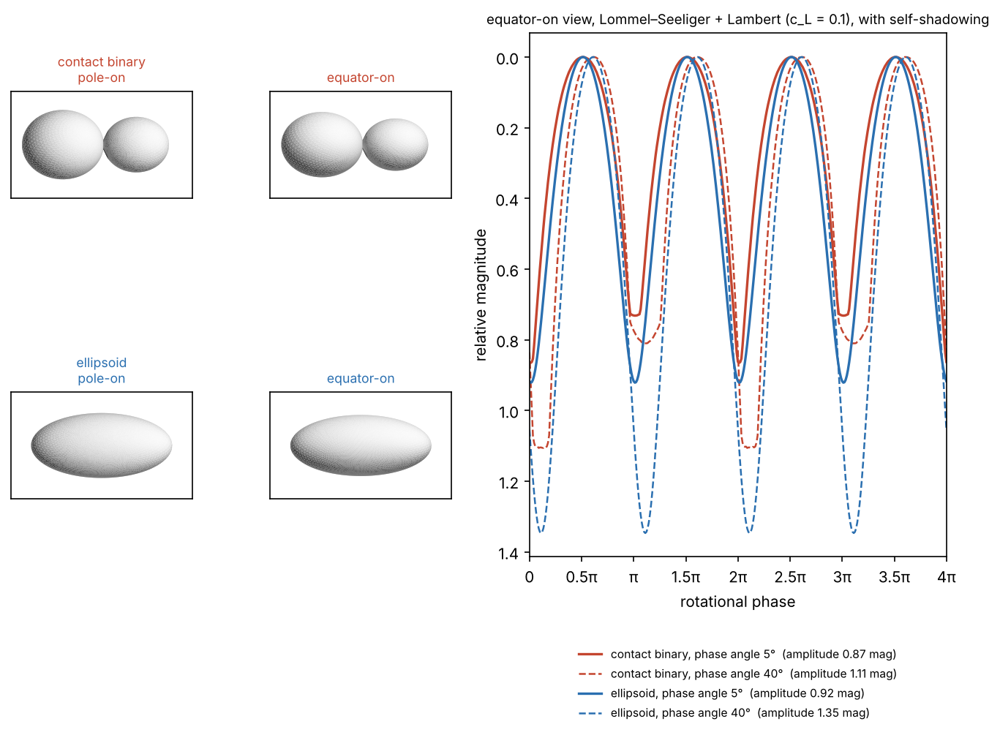

# Contact binary versus ellipsoid

Before fitting a two-lobe model to real data it helps to know what such a body does to a
lightcurve. The project ships a small, self-contained script that builds a contact binary and a
single ellipsoid of the same length and width, renders both with the scattering law that lcinv
uses, and compares the lightcurves at two phase angles.

**Needs:** NumPy, SciPy, Matplotlib only (no JAX). **Runtime:** about 30 s on one CPU core.

## Run it

```bash
cd examples
python contact_binary_lightcurve.py
```

It writes `contact_binary_lightcurve.png` and prints the amplitudes at an aspect angle of 60°:

<div class="run-output" markdown>

```text
contact binary 5 60 0.323
contact binary 40 60 0.398
ellipsoid 5 60 0.509
ellipsoid 40 60 0.684
```

</div>

The columns are model, phase angle (deg), aspect angle (deg) and peak-to-peak amplitude (mag).



## The models

| | Contact binary | Ellipsoid |
|---|---|---|
| shape | two overlapping ellipsoids, semi-axes \(1 : 0.85 : 0.8\), size ratio 1 : 0.8, centres 1.8 apart | semi-axes \(1.85 : 0.85 : 0.8\) |
| mesh | 6,000 radial vertices, scaled to unit volume-equivalent radius | same |
| scattering | Lommel–Seeliger plus Lambert, \(c_L = 0.1\) | same |
| shadowing | self-shadowing and self-occlusion by a point z-buffer (40 samples per facet) | same (has no effect on a convex body) |

The facet brightness is
\(S = \mu\,\mu_0\,\bigl[1/(\mu + \mu_0) + c_L\bigr]\), the same law as
[`lcinv.convex`](../reference/api/convex.md) with a fixed \(c_L\)
(see [Scattering law](../guide/scattering.md)), multiplied here by the visible and illuminated
fraction of each facet.

## What it shows

- **The minima are different, not the amplitude.** Seen equator-on, the ellipsoid's minima are
  smooth and V-shaped. The binary's minima are flat-bottomed: when the lobes line up along the line
  of sight, the smaller one is hidden behind the larger, and the projected area stays almost
  constant for a while. At 40° phase angle the second lobe also falls into the shadow of the
  first, which deepens and widens the flat part.
- **Amplitude alone does not identify a binary.** Equator-on, the two bodies reach 0.87 and
  0.92 mag at 5° phase angle; at an aspect of 60° the binary has the *smaller* amplitude
  (0.32 against 0.51 mag) because its waist is hidden by the viewing geometry.
- **The phase-angle trend is the familiar one.** Amplitudes grow with phase angle for both
  shapes (0.32 → 0.40 and 0.51 → 0.68 mag at 60° aspect), as shadows lengthen.
- **Convex models cannot make flat minima from shadows.** A convex shape has no self-shadowing,
  so it has to mimic the binary's minima with flat facets. This is why the contact-binary model of
  [`run_binary.py`](../reference/cli/run_binary.md) exists, and why the comparison is made on
  evidence: see [Contact-binary model](../guide/binary.md) and, for a real case, the 566130 rows in
  [Reference results](reference-results.md#566130-model-comparison).

## Changing the experiment

All settings are in the script: the lobe centres and semi-axes in `mesh()`, the phase angles in
the plotting loop, the aspect angle in `lightcurve(m, alpha, aspect_deg)` and \(c_L\) in its `cl`
argument. A finer z-buffer (`pix` in `visible()`) sharpens the shadow edges at the cost of time.
