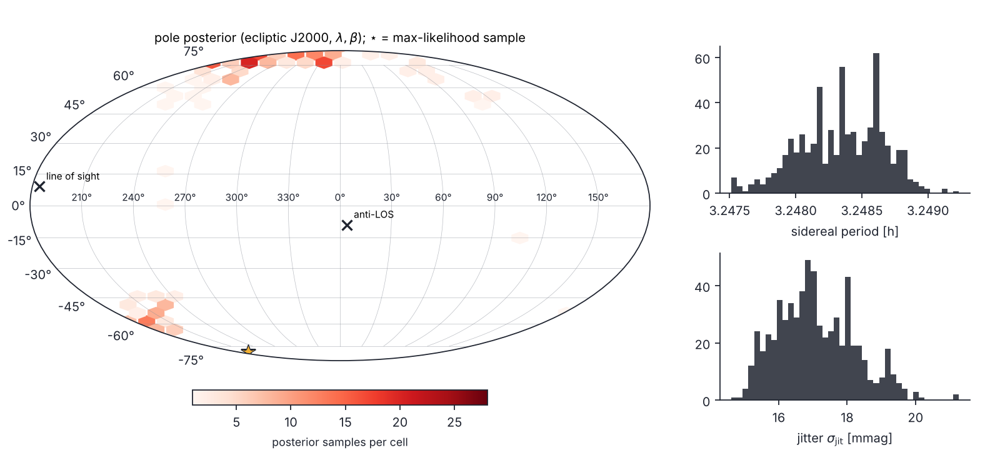
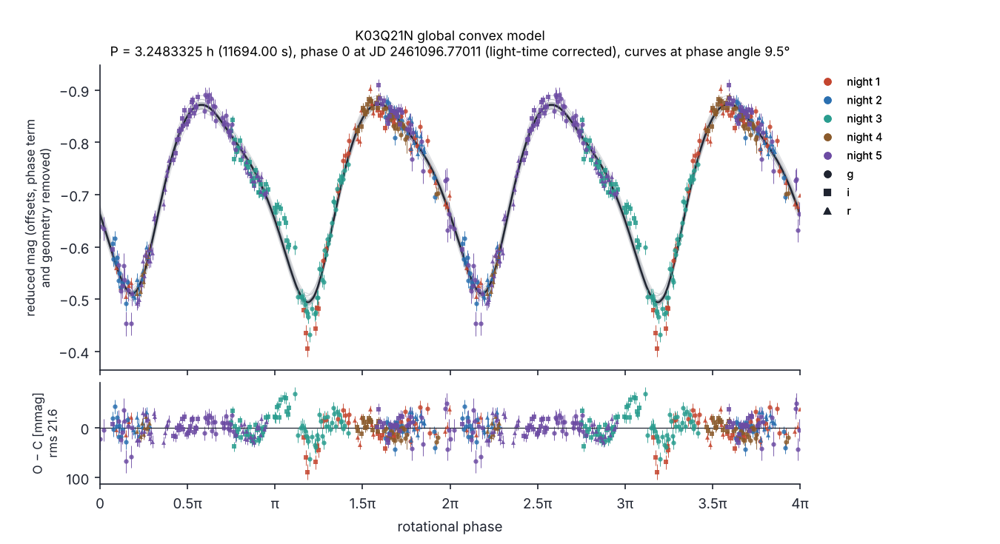

# Quickstart

This page runs a complete global inversion of the bundled Rubin lightcurve of 2003 QN21
(K03Q21N): 334 g, r and i points over five nights in February 2026. The Horizons geometry is
bundled too, so nothing is downloaded. Every command and every output below was produced exactly
as shown, on a 2-core machine.

!!! info "Short settings on purpose"
    The commands use 60 live points so that the whole page runs in about 20 minutes on a laptop.
    A production run uses the defaults (`--nlive 400 --dlogz 0.5`) or stricter; its results are
    in [Reference results](../examples/reference-results.md).

## 1. Run a first pass

From the repository folder:

```bash
python run_inversion.py data/K03Q21N.lc --designation K03Q21N --location X05 --cache-dir data \
    --nlive 60 --dlogz 1.0 --maxcall 4000 --npool 2 --n-post 40 --n-obj 5 --device cpu \
    --outdir runs/K03Q21N_quick
```

`--maxcall 4000` stops the sampler after 4,000 likelihood calls, which takes under five minutes.
The run prints:

<div class="run-output" markdown>

```text
JAX 0.12.0.1 backend=cpu devices=1 [cpu] preallocate=false
334 points, bands ['g', 'i', 'r'], nights 5; geometry vs file: {'delta_au': 1.454731914929397e-07, 'r_au': 2.5232026690247267e-07, 'alpha_deg': 3.6327119943280195e-06}
period 3.24826 h (Delta chi2=1: +-0.00028; threshold half-width 0.00142); amplitude 0.402+-0.007; a/b >= 1.337
nested sampling: 247 iterations, 4066 likelihood calls (efficiency 6.1%), 256 s, ln Z = 729.37 +- 1.63
== convergence: nested sampling: NOT CONVERGED ==
   ln Z = 729.37 +- 1.63 [fail]; evidence left in live points 100% (dlogz 11.77) [fail]; ESS 6 [fail]
   prograde fraction 0.221 +- 0.175 [fail]
   -> 100% of the evidence is still in the final live points: the run stopped early (--maxcall reached); rerun to completion or continue with --resume --extra-calls N
   -> posterior ESS is low: increase --nlive (e.g. x2) or lower --dlogz to 0.1
   -> ln Z is noisy: increase --nlive
best fit (convex): N = 334, p_eff = 14.9 (nominal 31), chi2_red = 3.47 (quoted errors) / 0.92 (with jitter 19.4 mmag), rms 21.9 mmag
done in 283 s -> runs/K03Q21N_quick
```

</div>

Reading it line by line:

- The **geometry check** compares Horizons with the distances and phase angles in the file:
  agreement to \(10^{-7}\) au and \(4\times10^{-6}\) degrees.
- The **period search** finds 3.24826 h, with a 0.40 mag amplitude that implies \(a/b \ge 1.34\).
- The **convergence report** fails on every check, and says why: the run hit `--maxcall` with all
  the evidence still in the live points. The posterior so far is not usable.

## 2. Finish the run from its checkpoint

Every run saves its sampler state in `<outdir>/dynesty.save`. Continue it, as the report
suggests:

```bash
python run_inversion.py data/K03Q21N.lc --designation K03Q21N --location X05 --cache-dir data \
    --nlive 60 --dlogz 1.0 --npool 2 --n-post 40 --n-obj 5 --device cpu \
    --outdir runs/K03Q21N_quick --resume --extra-calls 20000
```

<div class="run-output" markdown>

```text
finalised from checkpoint: 580 iterations, 19004 calls, 785 s, ln Z = 731.88 +- 0.40
== convergence: nested sampling: CONVERGED WITH WARNINGS ==
   ln Z = 731.88 +- 0.40 [ok]; evidence left in live points 32% (dlogz 0.39) [ok]; ESS 224 [warn]
   prograde fraction 0.491 +- 0.033 [ok]
   -> posterior ESS is low: increase --nlive (e.g. x2) or lower --dlogz to 0.1
best fit (convex): N = 334, p_eff = 15.1 (nominal 31), chi2_red = 3.37 (quoted errors) / 1.07 (with jitter 17.0 mmag), rms 21.6 mmag
```

</div>

The sampler stopped by itself at 19,004 calls, when the remaining evidence fell below
`--dlogz 1.0`. Only the effective sample size is still marked: 224 posterior samples is enough for
a first look, not for publication.

!!! note "lcinv 0.1.x"
    Before 0.2.0, `--resume` failed on a run that had ended normally or at `--maxcall`, with
    *"The remaining live points have already been added to the list of samples!"*. Update if you
    see this message.

## 3. Look at the results

`runs/K03Q21N_quick/` now holds the figures, the shapes and `summary.json`.



*`fig_pole_posterior.png`: two pole solutions, one near each ecliptic pole, the mirror pair that
one apparition cannot separate. The crosses mark the line of sight; both solutions view the body
nearly equator-on. The marginals show \(P = 3.2484\) h and a jitter of 17 mmag.*



*`fig_folded_lightcurve.png`: all five nights over two rotations with the maximum-likelihood
model and posterior draws, residuals below.*

The numbers are in `summary.json`:

```python
import json
s = json.load(open("runs/K03Q21N_quick/summary.json"))
p = s["posterior"]
print("P [h]      ", [round(x, 5) for x in p["P_h"]])            # 16th, 50th, 84th percentiles
print("jitter [mag]", [round(x, 4) for x in p["jitter_mag"]])
print("prograde    ", p["frac_prograde"])
print("a/b, b/c    ", round(p["ab"][1], 2), round(p["bc"][1], 2))
print("verdict     ", s["convergence"]["verdict"])
```

```text
P [h]       [3.248, 3.24836, 3.24866]
jitter [mag] [0.0159, 0.0169, 0.0182]
prograde     0.496875
a/b, b/c     1.43 0.87
verdict      CONVERGED WITH WARNINGS
```

Compared with the full reference run of the same data (250 live points), the period
(3.24828 h) and jitter (17 mmag) agree, and the prograde fraction (0.47) is within the errors. The
retrograde pole agrees to 5°; the prograde one, near the ecliptic pole, sits 23° from the
reference centre, inside its 95 % region. More live points sharpen exactly this.

## 4. Products

```bash
python make_viewer.py runs/K03Q21N_quick                    # interactive 3D viewer (HTML)
python export_obj.py runs/K03Q21N_quick --diameter-km 1.2   # meshes in km
```

## Next steps

- Sample shape and spin jointly in each spin state:
  [Hybrid model example](../examples/hybrid-k03q21n.md).
- Survey photometry from the MPC with exposure smearing:
  [ADES example](../examples/ades-566130.md).
- What every option does: [Global convex inversion](../guide/global-inversion.md).
