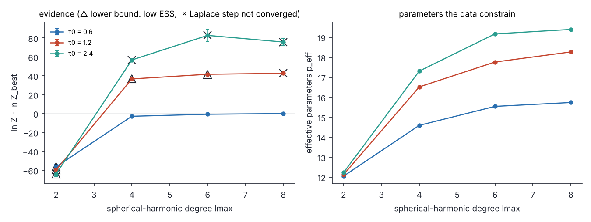

# Shape complexity and model comparison

How much shape detail do the data support, and which model describes them best? lcinv answers
both with the Bayesian evidence \(Z\), which already contains the Occam penalty for extra
parameters, and backs it with a goodness-of-fit measure that counts parameters honestly.

## Goodness of fit

Every run stores `fit_quality` for its best fit (convex and binary: maximum likelihood; hybrid: the
MAP of each spin state) and prints it:

```text
best fit (convex): N = 334, p_eff = 14.9 (nominal 31), chi2_red = 3.47 (quoted errors) / 0.92 (with jitter 19.4 mmag), rms 21.9 mmag
```

- \(\chi^2_\mathrm{red}\) **(quoted errors)** \(= \sum r_i^2/e_i^2 / (N - p_\mathrm{eff})\);
  **(with jitter)** uses the errors inflated by the fitted jitter and is about 1 by construction.
- \(p_\mathrm{eff} = \mathrm{tr}(H_\mathrm{lik} H_\mathrm{post}^{-1})\) is the number of
  parameters the data actually constrain. Shape coefficients shrunk by their prior count less
  than one; spin parameters and band offsets count fully; the jitter is a noise parameter and is
  not counted. `p_nominal` is the raw count.
- A \(\chi^2_\mathrm{red}\) (quoted) well above 1 means the model needs extra scatter: either the
  quoted errors are too small, or there is signal the model does not capture.

## Inferring the shape prior scale

`run_inversion.py --fit-tau` samples \(\ln\tau_0\) (log-uniform over `--tau-range`, 0.2–5) with
the spin state. The Laplace step marginalises the shape coefficients for each \(\tau_0\), so the
posterior of \(\tau_0\) is the data's verdict on how much shape freedom they support.
`--n-inner` defaults to 400 with `--fit-tau`, since 80 iterations do not converge for loose
priors. The hybrid model does the same with its hyperparameters \(\sigma_f\) and \(\ell\).

## Scanning complexity: `complexity_scan.py`

```bash
python complexity_scan.py results/566130_X05_cl --lmax 2 4 6 8 --tau0 0.6 1.2   # convex, no resampling
python complexity_scan.py results/566130_X05_hybrid --lmax 3 4 5 6 7            # hybrid (MAP + Laplace)
python complexity_scan.py results/566130_X05_cl --lmax 6 --tau0 1.2 --full      # full nested runs
```

For a convex run the finished posterior is reweighted,

\[
\frac{Z'}{Z} = \mathbb E_\mathrm{post}\Big[\frac{L'(\theta)}{L(\theta)}\Big],
\]

with \(L'\) the Laplace-marginalised likelihood at the new setting, so each \(l_\max\) is fully
marginalised over its own coefficients. The effective sample size of the weights says whether this
is reliable: when the posteriors differ a lot (ESS fraction below 0.1) the estimate is biased low
and is reported as a **lower bound**. Rows whose Laplace step did not converge are marked
unusable. `--full` (or `--print-commands`) reruns the base run at the other settings into
`<outdir>_lmax<L>[_tau<t>]/`, which `compare_models.py` picks up.

For a hybrid run, each spin state gets a MAP and a Laplace evidence of the radius-field model at
each \(l_\max\).

Outputs: `complexity_scan.json`, `fig_complexity.png`, and a table on screen.



*`fig_complexity.png` for the 566130 reference run (\(c_L\) fitted).*

For 566130, going from \(l_\max\) 4 to 6 to 8 gains +2.2 and then +0.7 in \(\ln Z\) at
\(\tau_0 = 0.6\) (saturating; \(p_\mathrm{eff}\) 14.6 to 15.7), while \(\tau_0 = 1.2\) gains at
least +40 (a lower bound; rms 33.7 to 27 mmag). The default shape prior was too tight for this
object, which is why its convex shape came out so round.

## Comparing models: `compare_models.py`

```bash
python compare_models.py results/566130_X05_cl results/566130_X05 results/566130_X05_smear \
       results/566130_X05_binary results/566130_X05_hybrid --out results/566130_comparison
```

writes `<out>.md`, `.csv` and `.json` with one row per model: convex variants, complexity-scan
rows, contact binary, hybrid. For each it gives N, \(p_\mathrm{eff}\), \(\chi^2_\mathrm{red}\)
(quoted errors and with jitter), rms, jitter, \(\ln Z\) and its error, \(\Delta\ln Z\) to the best,
the Jeffreys / Kass-Raftery reading, the posterior probability for equal prior odds, the
probability of being the best given the \(\ln Z\) errors (Monte Carlo), and convergence. A
recommendation follows: decisive or not, caveats about convergence, approximate evidences, lower
bounds that beat the best, fit adequacy and required cohesion.

| \(\lvert\Delta\ln Z\rvert\) | Reading |
|---|---|
| < 1 | not worth mentioning |
| 1–2.3 | weak |
| 2.3–5 | moderate |
| > 5 | strong |

Rules that keep the comparison honest:

- Only runs on **identical data** are compared, checked by a fingerprint of epochs, magnitudes,
  errors and bands (`lcinv.fitstats.data_fingerprint`); others are listed but excluded.
- Importance-sampled rows with low ESS are lower bounds: they get no probability but enter the
  recommendation.
- Hybrid evidences are Laplace approximations converted to the profiled-offset convention of the
  convex and binary runs, with an assumed uncertainty of ±2 (two hybrid runs of the same model in
  different pole parametrisations differ by about 3).

The batch runs it for every target (`model_comparison.md`; `--no-compare` skips it) and copies the
verdict into `batch_summary.csv`. The full table for 566130 is in
[Reference results](../examples/reference-results.md#566130-model-comparison).
