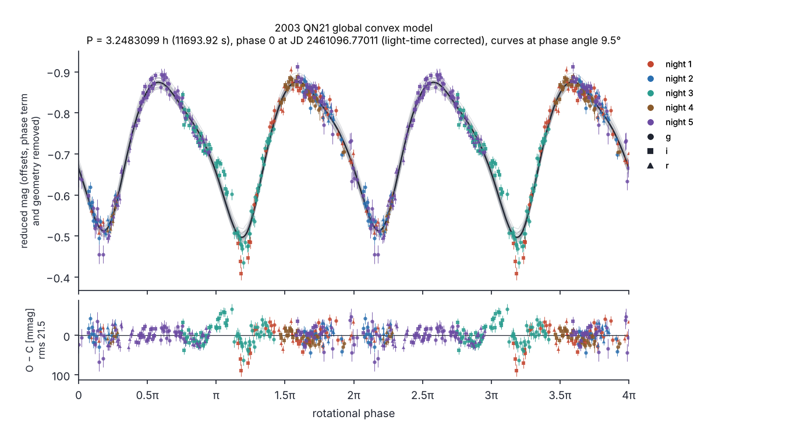

# Outputs, viewers and OBJ export

Every run writes a self-contained results folder. The figures and `summary.json` are produced
during the run; viewers, OBJ files and folded plots can be rebuilt from the folder at any time,
without resampling.

## Figures

| Figure | Global | Hybrid | Binary |
|---|---|---|---|
| period search | `fig_periodogram.png` | – | – |
| pole posterior | `fig_pole_posterior.png` | `fig_pole_hybrid.png` | `fig_pole_posterior.png` |
| parameter correlations | `fig_corner.png` | `fig_traces.png`, `fig_diagnostics.png` | `fig_corner.png` |
| data and model per night | `fig_lightcurves.png` | `fig_lightcurves_hybrid.png` | `fig_lightcurves.png` |
| folded over two rotations | `fig_folded_lightcurve.png` | `fig_folded_lightcurve_hybrid.png` | `fig_folded_lightcurve.png` |
| shape | `fig_shapes.png` | `fig_radius_maps.png` | – |



*`fig_folded_lightcurve.png` of the K03Q21N reference run.*

**How the folded plots are made.** The viewing geometry changes from night to night, so the model
curves are computed at one fixed reference geometry: the Sun and observer directions and phase
angle of the median epoch, in the r band. Each point is shown as
model\(_\mathrm{ref}\)(phase) + (data − model at its own geometry, offsets and phase term), so the
scatter about the curves is the actual misfit. Rotational phase 0 is at the model's
\(t_\mathrm{ref}\), light-time corrected. Points are coloured by night and marked by band. Global:
maximum-likelihood fit plus 30 posterior draws; hybrid: the best draw of the highest-weight spin
state plus draws of every spin state.

```bash
python make_folded_plots.py results/566130_X05_cl results/K03Q21N_hybrid_quat
```

## Interactive 3D viewers

```bash
python make_viewer.py results/K03Q21N                 # -> results/K03Q21N/shape_viewer.html
python make_uncertainty_viewer.py results/K03Q21N     # radius spread of the posterior shapes
python make_hybrid_report.py results/K03Q21N_hybrid   # hybrid figures and viewers
```

The viewers are single HTML files with three.js inlined; they work offline and can be sent to
anyone. For display, every shape is rotated about its spin axis so that its longest equatorial
axis lies along x: the rotational phase is a gauge freedom, so posterior draws are otherwise
arbitrarily rotated relative to each other. The OBJ files keep the physical orientation.

## OBJ export

```bash
python export_obj.py results/K03Q21N                      # global: maxlike, Minkowski mean, draws
python export_obj.py results/K03Q21N_hybrid_quat --n 50   # hybrid: mean/median/p16/p84 + draws per spin state
python export_obj.py results/X --diameter-km 1.2 --frame principal
```

| Run | Folder | Files |
|---|---|---|
| global | `<outdir>/obj/` | `shape_maxlike.obj`; `shape_mean.obj` (Minkowski mean: the convex body with the posterior mean facet areas); `draw_###.obj` |
| hybrid | `<outdir>/obj/spin_state_<k>/` | `shape_mean.obj`, `shape_median.obj`; `shape_p16.obj`, `shape_p84.obj` (±1σ radius envelopes); `draw_###.obj` |

- **Frames.** `--frame body` (default): z is the spin axis and the rotational phase is zero at
  \(t_\mathrm{ref}\) (in the file header), so draws are mutually aligned. `--frame principal`
  rotates each shape to its own principal axes (x longest), which suits 3D printing or comparison
  with other models but discards the spin orientation.
- **Units.** By default every shape has a volume-equivalent radius of 1. `--diameter-km D` scales
  to a volume-equivalent diameter of D km; `--scale s` sets the radius to s; `--size-from-H`,
  `--H` and `--albedo` use the [size estimate from H](physics.md#size-from-h).
- The meshes are watertight triangle meshes with outward normals, centred on the centre of mass.
  They open in Blender, MeshLab, ParaView and slicers for 3D printing. Each export replaces the
  `.obj` files of the previous one in the same folder.

## summary.json

The main machine-readable result. [Output files](../reference/outputs.md) documents its keys for
global, hybrid and binary runs, with values from the reference runs.
