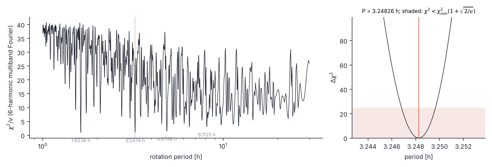

# Period search

Before any shape is fitted, `run_inversion.py` searches the rotation period with a multiband
Fourier series. The result sets the period prior of the nested sampling, the amplitude, the
lower bound on \(a/b\) and the outlier clipping. The search is pure NumPy (`lcinv.period`) and
takes seconds for single-apparition data.

## The model

At a trial period \(P\) the reduced magnitudes are fitted by weighted least squares with

\[
m_i = o_{b(i)} + s\,\alpha_i + \sum_{k=1}^{K} \big[a_k \cos k\varphi_i + b_k \sin k\varphi_i\big],
\qquad \varphi_i = 2\pi (t_i - t_0)/P,
\]

one offset \(o_b\) per photometric group, a linear phase-angle slope \(s\) and \(K\) harmonics
(`--harmonics`, default 6). Weights are \(1/\sigma_i\) with
\(\sigma_i^2 = \sigma_{\mathrm{rms},i}^2 + \sigma_\mathrm{sys}^2\) (`--sys-err`, default 0.015 mag).
With exposure times, each harmonic is attenuated by the exact \(\mathrm{sinc}\) factor of the
exposure, so the fitted series describes the un-smeared lightcurve
([Exposure smearing](smearing.md)).

## Search, refinement and uncertainty

1. **Coarse grid**, uniform in frequency, from `min(1 h, --pmin)` to `--pmax` (defaults 2 and
   30 h), with spacing \(1/(5 K T)\) for a data span \(T\).
2. **Best minimum** among periods \(\ge\) `--pmin`; the six lowest separated minima are stored in
   `summary.json` as `other_minima`, with their reduced \(\chi^2\).
3. **Fine scan** around that minimum. Its resolution grows with the number of rotations in the
   data, and it zooms in until the uncertainty is resolved.

Two uncertainties are reported:

- \(\Delta\chi^2 = 1\) after rescaling to \(\chi^2/\nu = 1\): the statistical error;
- the inversion threshold \(\chi^2 < \chi^2_\min (1 + \sqrt{2/\nu})\): a conservative interval
  that also covers model error.

```text
period 3.24826 h (Delta chi2=1: +-0.00028; threshold half-width 0.00142); amplitude 0.402+-0.007; a/b >= 1.337
```



*`fig_periodogram.png` of the K03Q21N reference run: the full search (left) and the fine scan
around the adopted period (right).*

!!! tip "Sub-hour periods"
    The default range 2 to 30 h will not find fast rotators. Set `--pmin`/`--pmax` to the range
    you want searched; for the 0.18 h rotator 566130 the batch tables use a 5 % window around the
    catalogue period.

## Warnings about the search range

A search whose range misses the true period still returns a best period, and the jitter then
absorbs the unexplained signal. Two checks run after every full-range search and print a line
starting with `WARNING (period search):`

- the periodogram, computed from `min(1 h, --pmin)`, has a **deeper minimum below `--pmin`**
  than the adopted one;
- the Fourier fit at the adopted period is **poor**, \(\chi^2/\nu > 3\).

The warnings are stored in `summary.json` under `period_search.warnings`. Either one means:
look at `fig_periodogram.png` and the folded lightcurve, and widen the range. The
[ADES example](../examples/ades-566130.md#what-happens-with-the-default-search-range) shows both
firing on a real fast rotator. They are not computed with `--search-window`.

## The period prior

The nested sampling uses a truncated Gaussian prior (`--period-prior gaussian`, the default)
centred on \(P_0\) with width \(\sigma_P\), cut at `--period-nsig` (5) sigma; or a uniform prior
over the same range (`--period-prior uniform`).

| | Default | Override |
|---|---|---|
| \(P_0\) | best period of the search | `--period` |
| \(\sigma_P\) | half-width of the threshold interval | `--period-sigma` |

## Amplitude and the a/b prior

The peak-to-peak amplitude \(A(\alpha)\) of the fitted series has a residual-bootstrap error. The
amplitude-phase relation \(A(0) = A(\alpha)/(1 + m\alpha)\) (Zappalà et al. 1990;
\(m = 0.030 \pm 0.010\), `--amp-phase-slope`) gives the equator-on value
\(2.5\log_{10}(a/b)\). For an unknown aspect this is a **lower bound** on \(a/b\).

`--ab-prior` uses it in the global layer:

| Value | Meaning |
|---|---|
| `lower` (default) | soft lower bound \(a/b \ge (a/b)_\min\) |
| `lognormal` | \((a/b)_\min\) as a central value |
| `none` | no a/b prior |

The width is the bootstrap error combined with `--ab-model-err` (0.05 in \(\ln a/b\)) for
non-ellipsoidal shapes and scattering; `--ab` and `--ab-sigma` override value and width.
`--bc-prior lower` (default, \(b/c \ge 1\)) asks for rotation about the shortest axis.

## Data spanning several apparitions

Over a baseline of \(N = T/P\) rotations, periods \(P^2/T\) apart differ by exactly one rotation
and fit the data almost equally well. For decades of data that is \(\sim 10^{-4}\) h, so:

- the coarse grid has \(\sim 10^{7}\) trial periods, each a full least-squares fit (hours), and
- a single Fourier series cannot follow a lightcurve whose shape changes between apparitions.

Give the period instead, restrict the search to a window around it, and switch off what depends
on the single Fourier fit:

```bash
python run_inversion.py data.csv --designation 3 --observer station \
       --period 7.209531 --period-sigma 8.4e-06 --search-window 0.00023 \
       --clip-sigma 0 --ab-prior none --fit-cl --npool 8 --outdir results/3_all
```

`--search-window W` searches only \(P_0(1 \pm W)\) (it requires `--period`). Choose
`--period-sigma` well below the alias spacing \(P^2/T\), for example a tenth of it, so that the
prior keeps one rotation count. The search still prints its own best period; with
`--period` set, the sampler uses your value and only the printed line comes from the Fourier fit.

## From Python

```python
import numpy as np
from lcinv import period as per
from lcinv.setup_data import prepare

D = prepare("data/K03Q21N.lc", "K03Q21N", location="X05", cache_dir="data")
sig = np.hypot(D["err"], 0.015)
P, chi2, nu = per.periodogram(D["t"], D["mag"], sig, D["band_idx"], D["alpha"], 1.0, 30.0, K=6, oversample=5)
best = per.local_minima(P[P >= 2], chi2[P >= 2], n=6)[0][0]
ref = per.refine_period_auto(D["t"], D["mag"], sig, D["band_idx"], D["alpha"], best, K=6)
print(f"P = {ref['P']:.5f} h, sigma = {ref['sigma']:.5f} h")
```

The full worked example, with the alias table and a figure, is
[Period search from Python](../examples/period-search-api.md).
