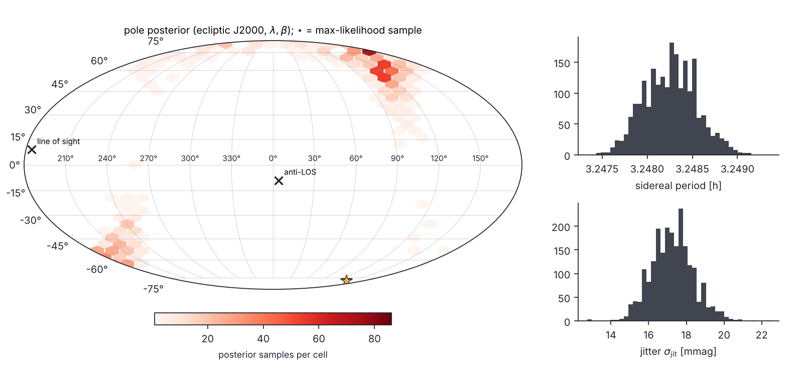
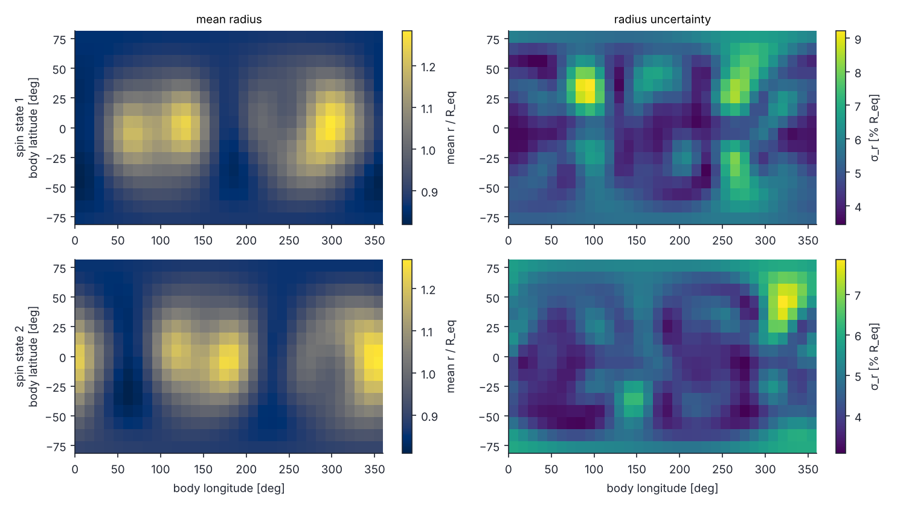

# Asteroid shapes and spins from sparse survey photometry, with honest uncertainties { .lc-hero__title }

lcinv inverts asteroid lightcurves into pole, rotation period and shape. A global
nested-sampling layer finds every spin solution and its evidence; a local NUTS layer then samples
shape and spin jointly within each solution. It reads Rubin-style lightcurves and MPC ADES files
directly.

<figure class="lc-hero__figure no-lightbox" markdown>
--8<-- "assets/hero_lightcurve.svg"
<figcaption class="lc-hero__caption">
2003 QN21 (K03Q21N), 334 Rubin points over five nights, folded at 3.24826 h and shown over two rotations
<i class="band-swatch g"></i>g <i class="band-swatch r"></i>r <i class="band-swatch i"></i>i, with the 6-harmonic model in ink
</figcaption>
</figure>

[Install](getting-started/installation.md){ .md-button .md-button--primary }
[Run the quickstart](getting-started/quickstart.md){ .md-button }
[Browse the options](reference/cli/run_inversion.md){ .md-button }

## From photometry to a shape model

<ol class="lc-pipeline" markdown>
<li markdown="block">

**Data and geometry**

Plain lightcurve CSV or ADES (CSV, PSV, XML). Sun and observer directions from JPL Horizons, cached, light-time corrected per station.

[Input data](guide/input-data.md)

</li>
<li markdown="block">

**Period search**

Multiband Fourier fit with free band offsets and a phase term. Gives the period prior, the amplitude and a lower bound on a/b.

[Period search](guide/period-search.md)

</li>
<li markdown="block">

**Global layer**

Convex shape, marginalised by Laplace. dynesty samples pole, period and jitter, finds all spin states and the evidence. `run_inversion.py`

[Global inversion](guide/global-inversion.md)

</li>
<li markdown="block">

**Local layer**

Star-shaped radius field with an inertia prior, sampled with spin by NUTS in each spin state. `run_hybrid.py`

[Hybrid model](guide/hybrid.md)

</li>
</ol>

<figure markdown>

<figcaption>The global layer: pole posterior of 2003 QN21, two mirror solutions of nearly equal weight, both requiring equator-on viewing.</figcaption>
</figure>

<figure markdown>

<figcaption>The local layer in each spin state: mean radius of the shape (left) and its posterior uncertainty, 3 to 9 % of the equatorial radius (right).</figcaption>
</figure>

## Where to go next

<ul class="lc-links" markdown>
<li markdown="block">[Quickstart](getting-started/quickstart.md)Install, run a global inversion on the bundled Rubin lightcurve, read the results.</li>
<li markdown="block">[How lcinv works](getting-started/concepts.md)The two layers, the phase gauge, the Laplace step and what each output means.</li>
<li markdown="block">[Vetted examples](examples/index.md)Nine worked examples, each run on the bundled data with the commands shown.</li>
<li markdown="block">[Command-line reference](reference/cli/index.md)Every option of every script, with defaults, generated from the code.</li>
<li markdown="block">[Python API](reference/api/index.md)The modules behind the scripts, for notebooks and custom pipelines.</li>
<li markdown="block">[Validation](validation.md)Synthetic recoveries, geometry checks and the test suite.</li>
</ul>
