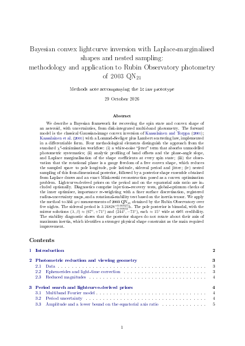
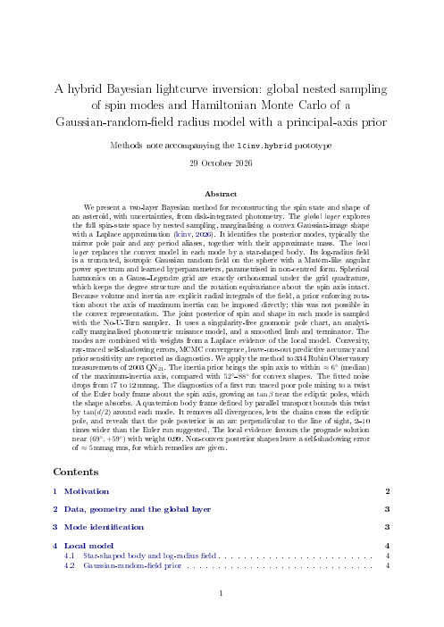

# Methods papers

Two methods notes ship with the package and describe the mathematics in full: derivations,
priors, diagnostics and the application to 2003 QN21. The user guide links to their sections
where a choice in the code follows from them.

<figure markdown>

<figcaption markdown>**[Bayesian convex lightcurve inversion with Laplace-marginalised shapes and
nested sampling](papers/lcinv_methods.pdf)** (PDF, 20 pages, 1.6 MB)</figcaption>
</figure>

<figure markdown>

<figcaption markdown>**[A hybrid Bayesian lightcurve inversion](papers/hybrid_methods.pdf)**
(PDF, 20 pages, 2.0 MB)</figcaption>
</figure>

## The global layer

*Bayesian convex lightcurve inversion with Laplace-marginalised shapes and nested sampling:
methodology and application to Rubin Observatory photometry of 2003 QN21.* Source:
`paper/lcinv_methods.tex`.

| Section | Covers | In these docs |
|---|---|---|
| 2 Photometric reduction and viewing geometry | ephemerides, light-time correction, reduced magnitudes | [Input data](guide/input-data.md) |
| 3 Period search and lightcurve-derived priors | multiband Fourier model, period error, amplitude and \(a/b\) bound | [Period search](guide/period-search.md) |
| 4 Forward model | spin state, Gaussian image, Lommel–Seeliger + Lambert, profiled offsets | [How lcinv works](getting-started/concepts.md), [Scattering law](guide/scattering.md) |
| 5 The rotational phase is a gauge freedom | why the sampled space is \((\lambda, \beta, P, \ln\sigma_\mathrm{jit})\) | [How lcinv works](getting-started/concepts.md) |
| 6–7 Shape priors, likelihood and shape marginalisation | smoothness prior, jitter, Laplace approximation, inner optimiser | [Global convex inversion](guide/global-inversion.md) |
| 8 Priors and nested sampling | spin priors, dynesty settings | [Global convex inversion](guide/global-inversion.md), [Convergence](guide/convergence.md) |
| 9 Posterior shape ensemble | shape draws, Minkowski reconstruction, radius maps | [Outputs](guide/outputs.md), [`lcinv.minkowski`](reference/api/minkowski.md) |
| 10 Diagnostics | injection–recovery, facet re-weighting, rotational stability | [Convergence](guide/convergence.md) |
| 11 Application to 2003 QN21 | the reference results | [Reference results](examples/reference-results.md) |
| Appendices | notation, algorithm summary | |

## The hybrid layer

*A hybrid Bayesian lightcurve inversion: global nested sampling of spin modes and Hamiltonian
Monte Carlo of a Gaussian-random-field radius model with a principal-axis prior.* Source:
`paper_hybrid/hybrid_methods.tex`.

| Section | Covers | In these docs |
|---|---|---|
| 2–3 Data, global layer, mode identification | how spin states are found and weighted | [Hybrid model](guide/hybrid.md) |
| 4 Local model | log-radius Gaussian random field, spherical harmonics on a Gauss–Legendre grid, inertia prior | [Hybrid model](guide/hybrid.md) |
| 5 Inference within a mode | MAP, Laplace evidence, NUTS, the gnomonic pole chart and quaternion frame | [Hybrid model](guide/hybrid.md) |
| 6 Combination of modes | weights from local Laplace evidences | [Hybrid example](examples/hybrid-k03q21n.md) |
| 7 Diagnostics | R-hat, ESS, divergences, PSIS-LOO | [Convergence](guide/convergence.md) |
| 8 Application to 2003 QN21 | | [Reference results](examples/reference-results.md#k03q21n-hybrid-model) |
| Appendices | settings, algorithm | [`run_hybrid.py`](reference/cli/run_hybrid.md) |

## Citing

Both notes are dated 29 October 2026 and accompany the prototype; cite them together with the
software version you used (`lcinv` 0.2.0 for these pages). The underlying convex-inversion
method is that of Kaasalainen & Torppa (2001) and Kaasalainen, Torppa & Muinonen (2001); the
sampler is dynesty (Speagle 2020) and the hybrid layer uses NumPyro's NUTS.
